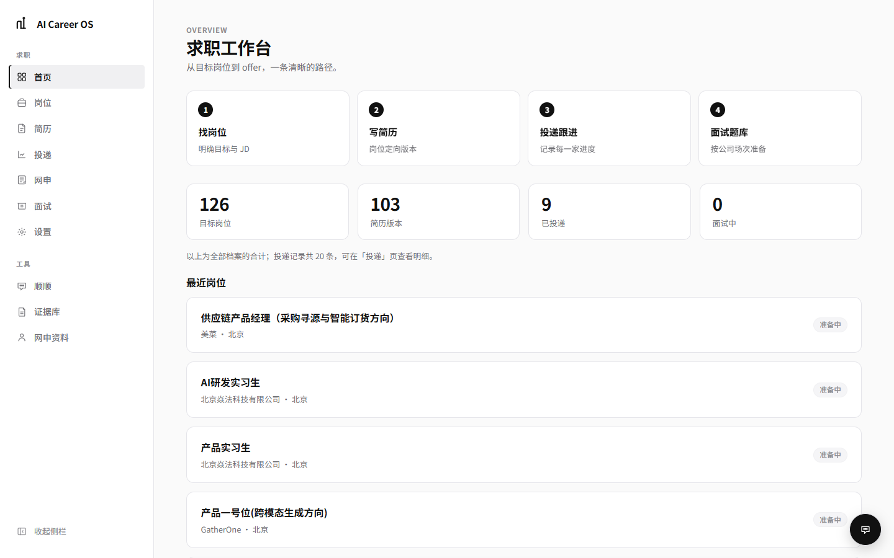
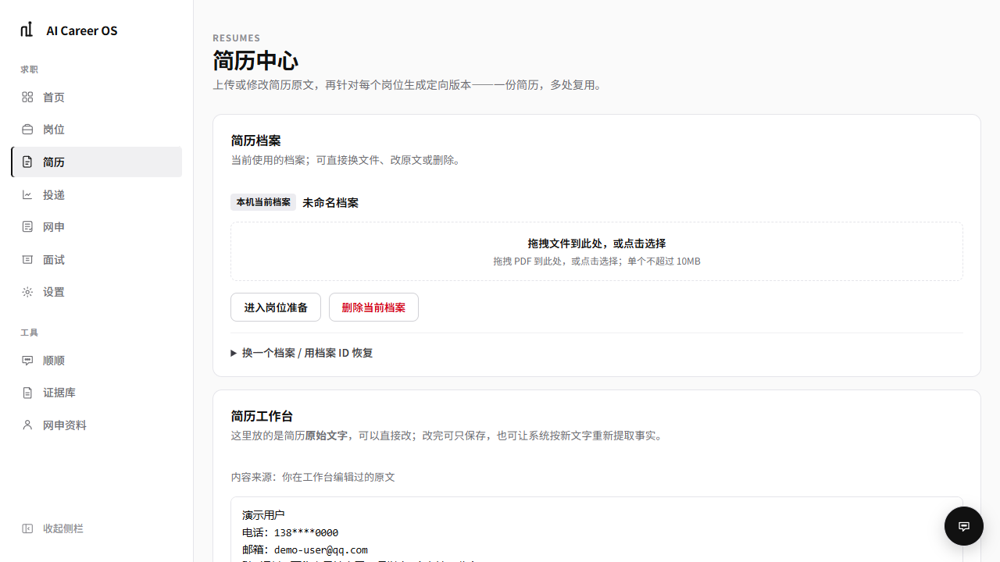
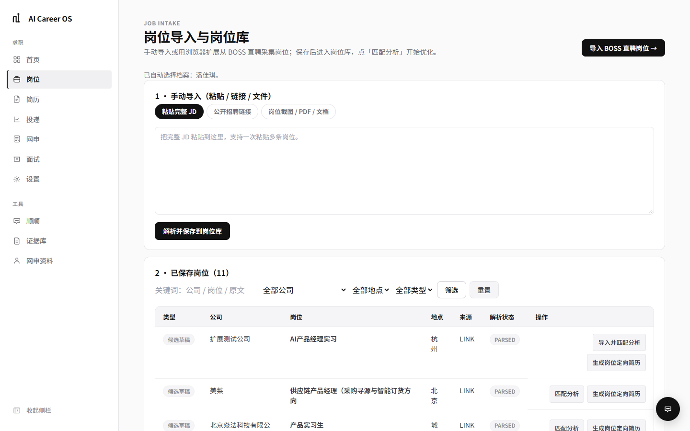
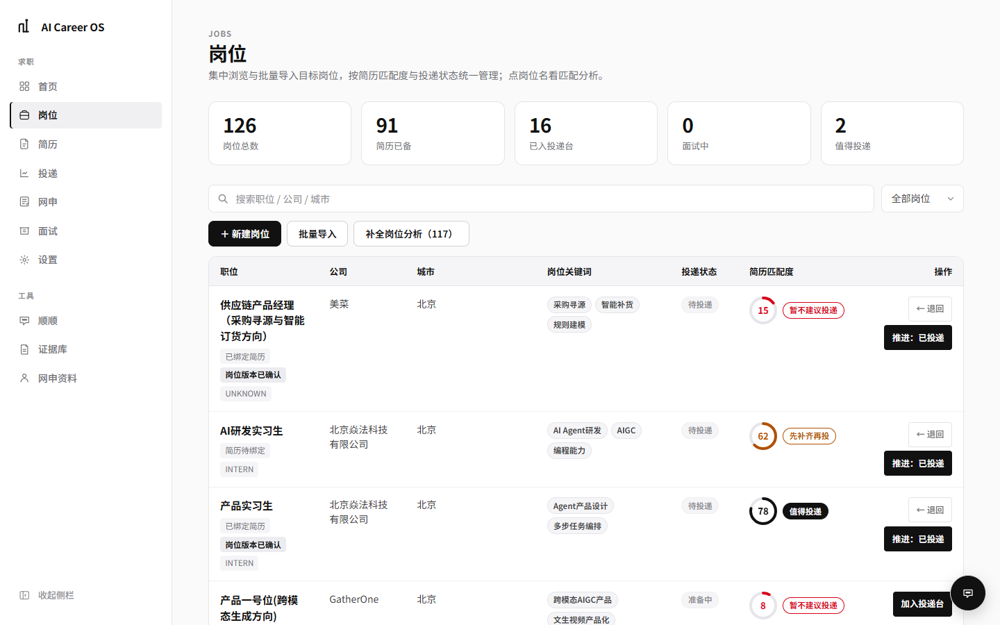
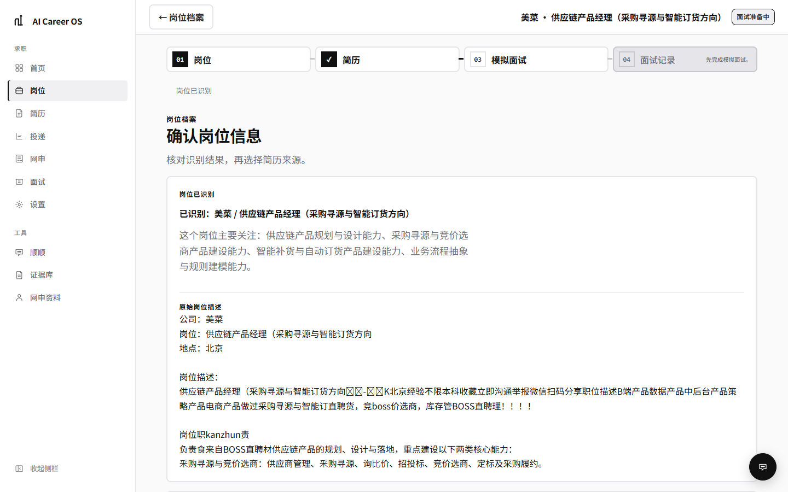
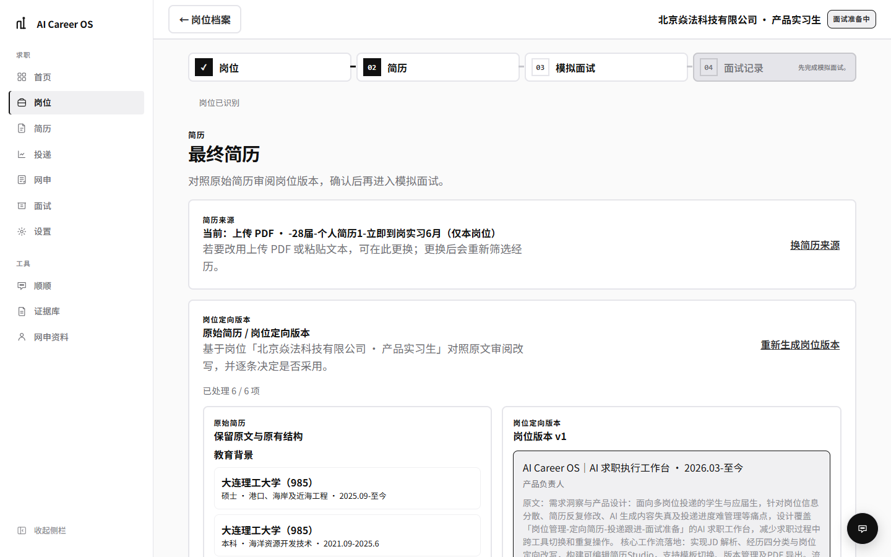
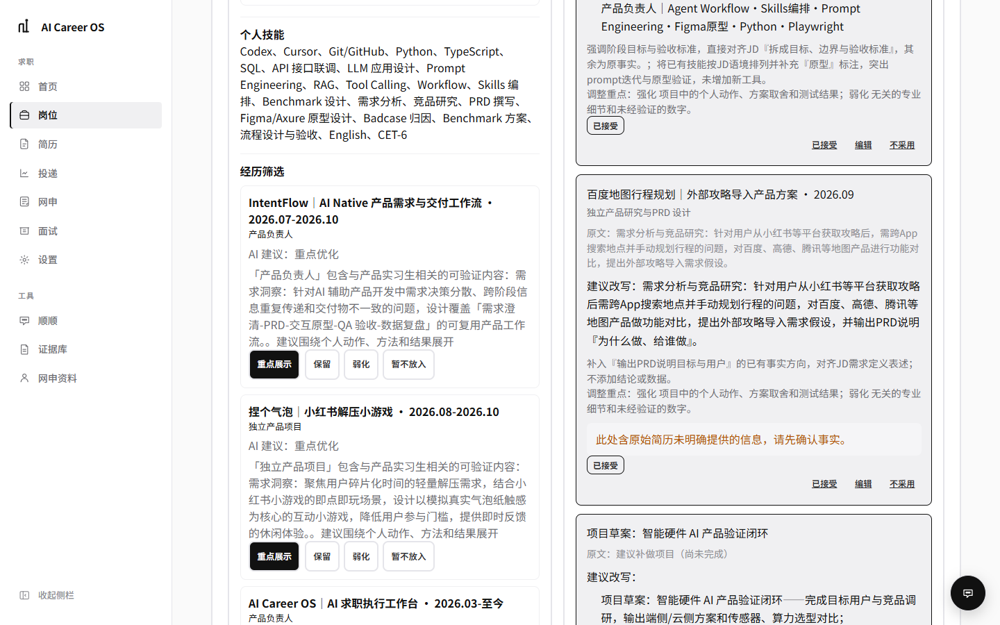
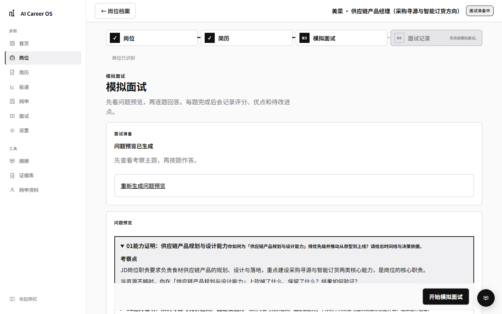
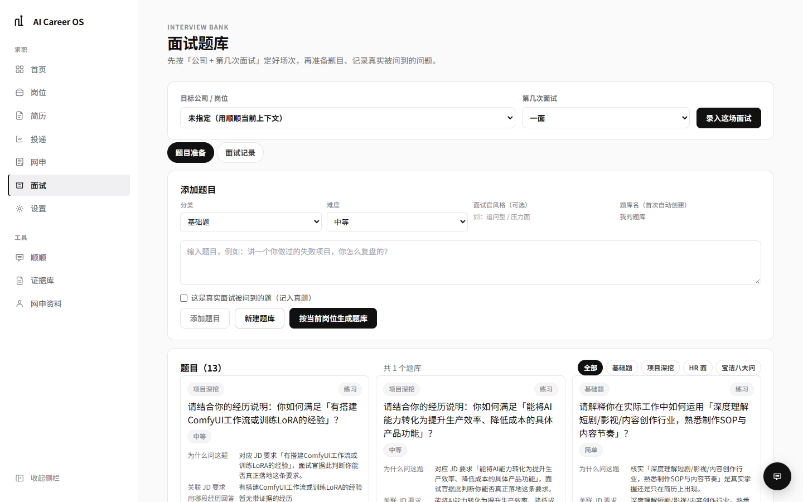
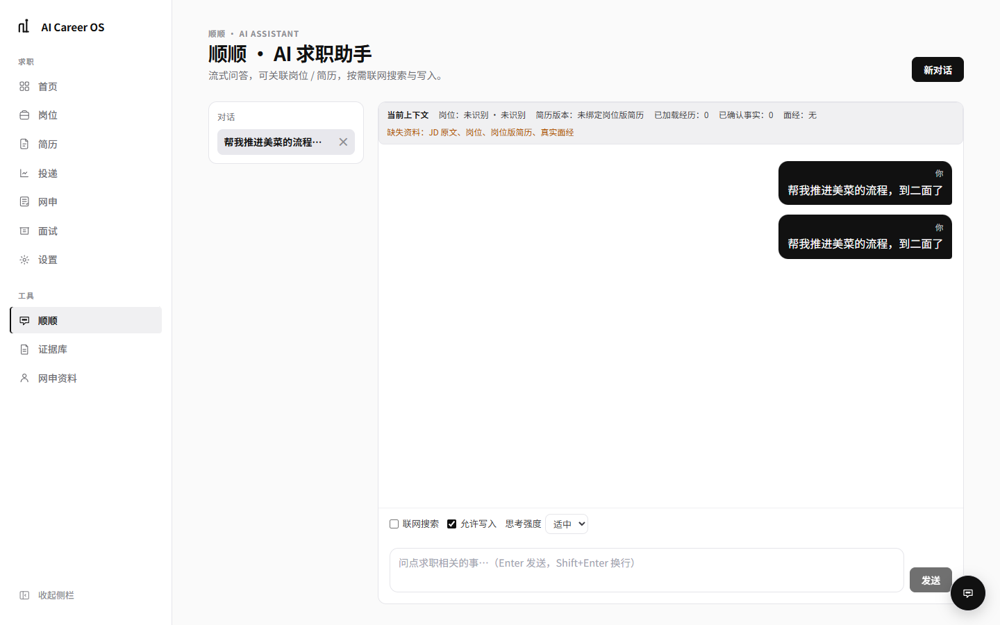

<div align="center">

# AI Career OS

**把「一份真实简历 + 一个具体岗位」变成一条可核对的求职准备闭环**

岗位导入（含 BOSS 直聘扩展采集）→ 匹配分析 → 定向简历改写（STAR 三框架）→ 模拟面试（宝洁八大问）→ 面试记录回流题库，全流程证据驱动、本地运行、逐步可回溯。

<sub>Next.js 15 · React 18 · TypeScript · FastAPI · SQLAlchemy 2.0 · SQLite · Edge 独立窗口 · OpenAI 兼容模型</sub>

</div>



---

## 目录

- [它解决什么问题](#它解决什么问题)
- [每一步的页面](#每一步的页面)
- [快速开始（Windows）](#快速开始windows)
- [桌面图标与浏览器扩展](#桌面图标与浏览器扩展)
- [技术架构](#技术架构)
- [目录结构](#目录结构)
- [测试](#测试)
- [设计原则](#设计原则)

---

## 它解决什么问题

- **一份简历投十个岗位，每个岗位都要手工改一遍。** 系统解析 JD，自动判断每段经历该**突出、保留、弱化还是排除**，生成岗位定向版本——改写时 AI 自动选择 **STAR / STAR-C / 能力证据链** 框架并标注理由。
- **通用 AI 改写不针对岗位，还容易编造。** 所有生成内容都受**事实门禁**约束：只能引用已确认的简历事实，模型不可用时降级为本地规则并在界面上标出来源。
- **面试准备和真实经历脱节。** 题库按**宝洁八大问**（目的性、领导力、计划性、说服力、协作力、创新性、前瞻性、学习力）组织，每题要求用真实经历按 STAR 作答；真实面试的题目会**自动回流进题库**，面得越多，准备越定向。
- **岗位收集太麻烦。** 支持粘贴 JD / 链接 / PDF，也提供 **BOSS 直聘浏览器扩展**：在岗位详情页点一下，职位描述就进岗位库，可直通工作台开始分析。

---

## 每一步的页面

> 以下均为**本地真实运行时的浏览器实拍**（1440 宽，示例为演示档案与岗位），不使用静态 Mock。

### 第 1 步 · 上传简历 —— 简历中心，一次上传多处使用

拖拽 PDF 建档案，之后**所有岗位共用这一份**，不需要每个岗位重新上传。简历工作台里可以直接改简历原文，改完让系统重新提取事实。



### 第 2 步 · 导入岗位 —— 手动导入 + 岗位库

「1 · 手动导入」支持粘贴完整 JD（一次可贴多条）、公开招聘链接、岗位配图/PDF/文档；「2 · 已保存岗位」是岗位库，点「匹配分析」直接开始优化。右上角按钮跳转 BOSS 直聘，配合浏览器扩展采集。



用 BOSS 直聘扩展采集时，保存后岗位直接进入工作台（详见[操作手册](docs/操作手册.md)第四节）。

### 第 3 步 · 岗位工作台 —— 匹配度、关键词、投递状态一表看清

每个岗位带 2~3 个**岗位关键词**、**简历匹配度圆环**（附「值得投递 / 先补齐再投 / 暂不建议投递」结论）与投递状态，行内可直接推进 / 退回。



### 第 4 步 · 岗位档案 01 —— 确认岗位信息

核对识别出的公司、岗位与关注点，保留原始 JD 原文以便核对。顶部流程条：**01 岗位 → 02 简历 → 03 模拟面试 → 04 面试记录**。



### 第 5 步 · 岗位档案 02 —— 定向简历 + STAR 三框架改写

进入岗位并分析后**直接开始优化**，不需要重复上传简历。AI 为每段经历自动选择改写框架：

- **STAR**（情境-任务-行动-结果）：普通项目；
- **STAR-C**（+商业影响）：有明确业务价值的项目；
- **能力证据链**：需要多段经历共同证明同一个能力。

改写说明会标注所选框架与理由，逐条采纳 / 编辑 / 不采用，最后确认生成投递版。



经历筛选与原文对照：每段经历标「重点优化 / 保留 / 弱化 / 暂不放入」，右边是岗位版本草稿，所有改写都可回溯到原文。



### 第 6 步 · 岗位档案 03 —— 模拟面试

先看问题预览与考察点，再逐题作答；每题完成后给出评分、优点与待改进点。行为面环节按**宝洁八大问**出题，要求用真实经历按 STAR 作答。



### 第 7 步 · 面试题库 —— 越面越准

按「公司 + 第几次面试」准备题目、记录真实被问到的问题。分类筛选项含**宝洁八大问**；每道题都能看到「为什么问这道」「用哪段经历回答」与参考答案。**真实面试记录的题目和已完成的模拟面试会自动回流进题库**，重复不累积。



### 第 8 步 · 顺顺 —— AI 求职助手

流式回答、多会话历史保留、可读当前岗位上下文、可选联网搜索。



### 更多工具

| 页面 | 说明 |
|---|---|
| **投递** | 状态机管理（待投递 → 已投递 → 笔试 → 面试 → Offer），可逐级推进、也可退回 |
| **证据库** | 8 步事实流转：录入证据 → 建立主张 → 解析岗位 → 匹配差距 → 定位成稿 → 主张审计 → 确认定稿 → 渲染评估 |
| **网申资料** | 集中管理身份证、家庭情况等敏感字段；**不写入简历**，助手也读不到 |

---

## 快速开始（Windows）

### 一键安装 + 一键启动

```text
1. 下载项目（git clone 或 Download ZIP）
2. 双击 install.cmd          ← 装依赖 + 创建桌面图标
3. 根目录创建 .env 填入模型密钥
4. 双击桌面「AI Career OS」   ← Edge 独立窗口打开
```

`.env` 模板（支持任意 OpenAI 兼容端点）：

```env
OPENAI_API_KEY=你的密钥
OPENAI_BASE_URL=https://api.openai.com/v1
OPENAI_MODEL=gpt-4o-mini
```

详细的首次安装、启动/停止、数据位置与常见问题见 **[操作手册](docs/操作手册.md)**。

### 手动启动（开发模式）

```bash
# 后端
cd apps/api
python -m venv .venv
.venv/Scripts/pip install -r requirements.txt
set PYTHONPATH=.
.venv/Scripts/python -m uvicorn app.main:app --host 127.0.0.1 --port 8100

# 前端（另开终端）
cd apps/web
npm install
set NEXT_PUBLIC_API_BASE_URL=http://127.0.0.1:8100
npm run dev -- -H 127.0.0.1 -p 3000
```

---

## 桌面图标与浏览器扩展

- **桌面图标**：`install.cmd` / `create-desktop-shortcut.ps1` 创建「AI Career OS」（启动）与「停止 AI Career OS」（停止）两个快捷方式，启动后以 Edge 独立应用窗口呈现，外观等同桌面软件。
- **BOSS 直聘扩展**（`apps/extension`，当前 v1.3.4）：未上架商店，需在 `edge://extensions` 开启开发人员模式后「加载解压缩的扩展」一次性装入；与本机后端令牌配对后，在岗位详情页一键采集，自动清理页面水印噪声，保存后直通工作台。

> 合规：扩展只在你主动点击时读取你正在浏览的单个岗位页，不做自动沟通、不做批量投递。

两部分的完整步骤、截图说明与排错见 **[操作手册](docs/操作手册.md)**。

---

## 技术架构

| 层 | 技术 |
|---|---|
| **前端** | Next.js 15（App Router）· React 18 · TypeScript · Tailwind CSS |
| **后端** | FastAPI · SQLAlchemy 2.0 · Alembic · Pydantic 2 |
| **数据库** | SQLite（本地单机，`%LOCALAPPDATA%\AICareerOS`） |
| **桌面形态** | PowerShell 启停器 + Edge `--app` 独立窗口 + 桌面快捷方式 |
| **浏览器扩展** | Chrome MV3（Edge 兼容），令牌配对 + 本机桥接 |
| **文档解析** | PyMuPDF（PDF 文本提取）· Typst（PDF 排版导出） |
| **模型** | OpenAI SDK，兼容任意 OpenAI 式端点 |
| **知识库** | `knowledge/interview_skills/`（企业面经）· `knowledge/resume_skills/`（简历写作规范） |

**事实门禁**：所有对外输出的内容（匹配理由、参考答案、简历改写）只能引用已确认的事实（`READY / CONFIRMED / SUPPORTED` 的主张与已确认版本的简历要点），系统不编造经历与数字。

---

## 目录结构

```text
ai-career/
├─ install.cmd                  # 一键安装（依赖 + 桌面图标）
├─ create-desktop-shortcut.ps1  # 创建桌面启动/停止快捷方式
├─ apps/
│  ├─ api/                      # FastAPI 后端（路由、服务、模型、迁移、测试）
│  ├─ web/                      # Next.js 前端（页面、组件、数据层）
│  └─ extension/                # BOSS 直聘采集扩展（MV3）
├─ scripts/local-app/           # Windows 启停器（career-app.ps1 等）
├─ knowledge/                   # 面经与简历写作知识库
├─ docs/
│  ├─ 操作手册.md               # 安装 / 桌面图标 / 扩展 / FAQ
│  └─ screenshots/              # README 逐页实拍截图
└─ evals/                       # 评测基准
```

---

## 测试

```bash
# 后端
cd apps/api
.venv/Scripts/python -m pytest -q

# 前端
cd apps/web
npm test
npm run type-check

# 扩展安全性 E2E
node apps/web/scripts/e2e-extension-safety.cjs
```

---

## 设计原则

1. **原始简历是唯一事实来源。** 改写只改变措辞与取舍，不新增未经确认的事实。
2. **生成与确认分离。** AI 负责建议，人负责确认；每条进入简历的内容都可回溯到原文。
3. **降级可见。** 模型不可用时走本地规则，并在界面标注来源，绝不静默失败。
4. **一岗一版。** 每段经历针对岗位做突出 / 保留 / 弱化 / 排除，而不是套用一个通用模板。
5. **闭环。** 面试的结果回流到题库、证据与简历，让每一次面试都变成下一次的弹药。
