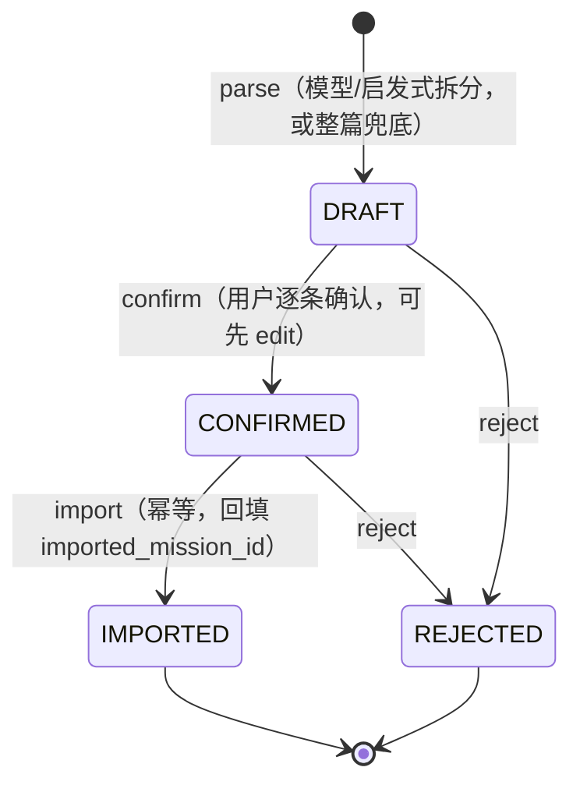

# Phase 1 · 产品设计 + 数据模型审计

> 日期：2026-10-12　分支：`feature/workbuddy-ui-func-opt`
> 范围：**只做产品设计与数据模型审计，不做大规模改代码**。
> 本文档描述的是**设计意图与差距**，不是已交付效果。凡未真实运行/未取到真实样本的，一律标注 `NOT_RUN`。

---

## 0. 执行模式与本次唯一代码改动

| 项目 | 状态 |
|---|---|
| 本阶段定位 | 产品设计 + 数据模型审计（不立即大规模改代码） |
| 唯一代码改动 | 修复岗位卡片「已投递 / 待投递」自相矛盾（§1.1） |
| 新增迁移 | 无（迁移编号规划见 §10） |
| API 定向测试 | `NOT_RUN`（本阶段未改 API） |
| Web 定向测试 | 已运行：192 pass / 2 fail（2 例为改动前既有失败，见 §12） |
| TypeScript 类型检查 | 已运行：`tsc --noEmit` 退出码 0 |
| Web production build | `NOT_RUN`（本阶段未改构建产物） |
| `git diff --check` | 已运行：无空白错误 |

**诚实声明**：本阶段没有真实样本评测、没有人工评分，因此**不产出任何“准确率/效果”数字**。任何效果类指标均为 `NOT_RUN`。

---

## 1. 用户实测暴露的两个问题

### 1.1 岗位卡片状态自相矛盾（已修复）

**现象**：同一张岗位卡片，右上角徽标写「已投递」，卡内小标签却写「待投递」。

**根因（已定位到代码）**：`apps/web/app/missions-home.tsx`

- `stageOf(item)` 把投递状态坍缩成 4 个「阶段桶」，只按 `target_resume_confirmed` 与少量状态分支区分为 `PREPARING / APPLIED / INTERVIEW / CLOSED`；
- 任何**非空**且非 `CLOSED/INTERVIEW/OFFER` 的状态（包括 `PENDING`）都被折叠成 `APPLIED`；
- 右上角徽标走 `stageLabel(stageOf(item))` → `PENDING` 被渲染成「已投递」；
- 卡内小标签走 `APPLICATION_STATUS_LABEL[status]` → `PENDING` 正确渲染成「待投递」。

两套映射指向同一字段却得出不同中文，于是出现「已投递 / 待投递」并存。

**修复方式**（`apps/web/app/missions-home.tsx`）：

1. 右上角徽标改为**直接取真实投递状态**：`cardStatusLabel(item)` → `APPLICATION_STATUS_LABEL[status]`；无投递记录时才回退为「简历已备 / 准备中」。
2. 徽标配色 `cardStatusClass(item)`：`PENDING`→`muted`，`CLOSED`→`attention`，其余（已进入流程）→`filled`。
3. 移除卡内重复的状态小标签，状态**只由右上角徽标单一呈现**，从结构上杜绝两处不一致。
4. 筛选器 `APPLIED:已投递` 名实不符（该桶其实含 `PENDING`），改为 `TRACKER:投递台`（= 存在投递记录），语义与「加入投递台」按钮、统计卡「已入投递台」一致。
5. 统计卡第 4 格改用 `isInterviewing()`，与「面试中」筛选口径一致。

修复后：`PENDING → 待投递`、`APPLIED → 已投递`、`SCREENING → 筛选中`……徽标与任何其他地方都取自同一映射表 `APPLICATION_STATUS_LABEL`。

### 1.2 「每次都上传简历」冗余 + 母版简历诉求

**现象**：每个岗位都要重新上传/绑定一份 PDF（截图 2：「简历来源：当前：上传 PDF · 简历10.8（仅本岗位）」），用户认为冗余。

**用户期望**：上传几份简历作为**母版**，后续岗位都在母版上派生/修改，而不是每个岗位重传。

**归类**：这是 **目标四（ResumeProfile / ApplicationProfile 边界）** 的核心诉求，本阶段给出数据模型与交互设计（§6），不在本阶段落地代码。

**现状审计**：
- 简历来源经 `JobMission.resume_source`（JSON）承载，`isolation` 取值含 `mission_local`（仅本岗位）与 `shared_master`（可用于多个岗位）。
- 也就是说「母版 / 派生」的**概念位已经存在**，但缺少一等实体：没有 `resume_master`（母版简历库）表，没有「从母版派生岗位版本」的显式链路，UI 也没有「选择已有母版」的一等入口，导致体感仍是「每次都上传」。

---

## 2. 现状数据模型审计（as-is）

### 2.1 关键表清单（`apps/api/app/models.py`，迁移至 `018_assistant`）

| 领域 | 表 | 关键字段 |
|---|---|---|
| 档案 | `user_profiles` | status( DRAFT/CONFIRMED ), full_name, phone, email, city |
| 档案子项 | `education` | institution, degree, field_of_study, dates, relevant_courses[], honors[] |
| | `profile_skills` | name, proficiency |
| | `experiences` | title, organization, dates, description, **experience_type**(WORK/INTERNSHIP/CAMPUS/PROJECT/OTHER) |
| | `certifications` | name, issuer, date, **score**, **status** |
| 岗位 | `target_jobs` | raw_text, content_hash, status, requirements[], capabilities[] |
| | `job_missions` | company, role, role_family, seniority, location, status, **workflow_state**, **resume_source(JSON)**, parsed_jd, what_matters, resume_strategy, interview_intel |
| | `mission_experience_selections` | experience_id, **decision**(KEEP_AND_HIGHLIGHT/KEEP/DEEMPHASIZE/OMIT), why, evidence_refs |
| 定向简历 | `target_resumes` / `target_resume_bullets` | version, status, bullets(original/suggested/final, jd_refs, evidence_refs, resume_skill_refs, risk_flags) |
| 简历工作台 | `resume_studio_documents` | mission_id(unique), source_target_resume_id, **template_id**, document_json, confirmed_revision |
| 面试（模拟） | `interview_sessions` / `interview_turns` | claim_id, mission_id, round_count, next_question, evaluation |
| 面试（真实记录） | `interview_records` / `interview_record_items` | company, interview_round, interviewed_on, items(question, my_answer, evaluation) |
| 补强 | `proof_actions` / `proof_artifacts` | claim_id, target_gap, status, artifact_type |
| 投递 | `job_applications` | mission_id, company, role, channel, **status**(PENDING→CLOSED), applied_at |
| 助手 | `assistant_conversations` / `assistant_messages` | surface(page/orb), role, content, tool_calls, sources |
| | `referrals` / `reminders` | company/contact/status；title/due_at/status |
| 事实主张 | `resume_claims` | claim, current_text, suggested_text, **evidence_refs**, readiness_status, confidence, attack_surface |

### 2.2 七项能力 vs 现状（gap 总表）

| 目标 | 现状 | 关键缺口 | 结论 |
|---|---|---|---|
| 一 · 候选岗位暂存区 | 无候选表；`parse-batch` 直接 → `bulk-create` 建 `JobMission` | 无草稿/确认/幂等/溯源 | **需新表** |
| 二 · 评测问题修复 | 见 `docs/evaluation/2026-10-09-问题汇总.md`（P0×5 / P1×4） | 分类/抽取/门控/一致性 | **需修逻辑** |
| 三 · 题库与模拟面试拆分 | 有 `interview_packs.topics(JSON)` + `interview_records` | 无独立题库、无三分类、无参考答案事实门控 | **需新表+门控** |
| 四 · Resume/Application Profile 边界 | 单表 `user_profiles`；`certifications.score/status` | 无边界、无 CET 分数字段、无草稿态 | **需拆表/加列** |
| 五 · 模板工作台 | `resume_studio_documents.template_id` + `document_json` | 无版式配置对象、无 HTML/参考模板导入、无统一版式 SoT | **需版式模型** |
| 六 · 统一拖拽导入 | 各页各自 `<input type=file>` | 无共享组件、无统一校验/拒绝原因 | **需抽组件** |
| 七 · 助手写入安全 | `allow_write` 开关 + 写工具直写库 | 无提案/回执/能力目录 | **需提案层** |

---

## 3. 目标一 · 候选岗位暂存区

### 3.1 现状链路审计

```
粘贴多份 JD ──parseJobBatch──▶ JobDraft[] ──bulkCreateMissions──▶ 直接创建 JobMission
（apps/web/app/job-batch-import.tsx → career-hub.ts → /job-missions/parse-batch → /job-missions/bulk-create）
```

问题：
- 模型拆分结果**直接落正式岗位**，用户没有逐条确认的落点；
- 无 `source_excerpt`，拆分错了**无法回溯**这句来自原文哪一段；
- 无 `source_hash`，同一段 JD 重复粘贴会重复建岗（不幂等）；
- 无 `status` 生命周期，错分的岗位只能删。

### 3.2 目标模型：`candidate_jobs`

| 字段 | 类型 | 说明 |
|---|---|---|
| `id` | UUID PK | |
| `profile_id` | UUID FK→user_profiles | 归属档案 |
| `source_text` | Text | 本次粘贴的完整原文（整批） |
| `source_hash` | String(64) | `source_text` 归一化后 sha256，用于批次幂等 |
| `source_kind` | String(32) | `PASTE` / `FILE_TXT` / `FILE_PDF` / `FILE_DOCX` / `LINK` |
| `recognition_source` | String(32) | `MODEL_SPLIT` / `HEURISTIC_SPLIT` / `MANUAL` / `WHOLE_TEXT` |
| `source_excerpt` | Text | 本条对应的原文摘录，**必须能在 `source_text` 中找到** |
| `company` | String(255) | 可为空（原文无 → 留空，不臆造） |
| `role` | String(255) | 同上 |
| `location` | String(255) | 同上 |
| `raw_payload` | JSON | 模型原始输出（含 confidence、warnings），供审计 |
| `status` | String(16) | `DRAFT` / `CONFIRMED` / `IMPORTED` / `REJECTED` |
| `imported_mission_id` | UUID FK→job_missions NULL | 导入后回填；幂等依据 |
| `created_at` / `updated_at` | DateTime | |

约束与索引：
- `UniqueConstraint(profile_id, source_hash, source_excerpt_hash)` —— 同一批同一段不重复生产草稿；
- `Index(profile_id, status)`；
- `imported_mission_id` 非空即表示为「已导入」，二次导入直接返回该 mission（幂等）。

> 建议：额外存 `source_excerpt_hash`（`source_excerpt` 归一化后 sha256），避免长文本做唯一约束。

### 3.3 多 JD 拆分规则（落地方式）

| # | 规则 | 实现落点 |
|---|---|---|
| 1 | `source_excerpt` 必须能在原文找到 | 落库前做「归一化包含」校验，失败则降级为整篇草稿 |
| 2 | 比对忽略空格/换行，但不改语义 | 归一化仅做 `\s+→""`、全半角统一、大小写统一；**禁止**同义替换 |
| 3 | 无法可靠拆分 → 返回一份完整草稿 | 兜底：`recognition_source=WHOLE_TEXT`，`source_excerpt=source_text` |
| 4 | 不允许模型补充原文没有的公司/岗位/地点/要求 | 落库前对 `company/role/location` 做「在 excerpt 中出现」校验，不满足则置空 + `warnings` |
| 5 | 每份候选显示识别来源、原文摘录与警告 | 前端卡片展示 `recognition_source` + `source_excerpt` + `raw_payload.warnings` |
| 6 | 正式导入必须幂等 | 见 §3.2 唯一约束 + `imported_mission_id` |
| 7 | 助手不能静默导入 | 助手只允许产出 `WriteProposal`（§9），用户确认后才执行导入 |

### 3.4 API 设计（草案）

| 方法 | 路径 | 说明 |
|---|---|---|
| POST | `/api/v1/profiles/{profile_id}/candidate-jobs/parse` | 粘贴/上传原文 → 生成候选草稿（DRAFT），返回含 `source_excerpt`/`warnings` |
| GET | `/api/v1/profiles/{profile_id}/candidate-jobs?status=` | 列出候选（默认 DRAFT/CONFIRMED） |
| PATCH | `/api/v1/candidate-jobs/{id}` | 编辑 company/role/location（用户确认阶段）|
| POST | `/api/v1/candidate-jobs/{id}/confirm` | DRAFT → CONFIRMED |
| POST | `/api/v1/candidate-jobs/{id}/reject` | → REJECTED |
| POST | `/api/v1/candidate-jobs/{id}/import` | CONFIRMED → 建 `JobMission`，回填 `imported_mission_id`，**幂等** |
| GET | `/api/v1/candidate-jobs/{id}` | 详情（含原文摘录与溯源） |

### 3.5 前端：逐条确认

改造 `job-batch-import.tsx`：`粘贴 → 生成候选（草稿） → 逐条确认/编辑/拒绝 → 导入`。
每条候选卡片显示：公司/岗位/地点、`识别来源`（模型拆分/启发式/整篇）、**原文摘录**、警告徽标；导入按钮单条触发，导入成功后卡片变为「已导入」并给出跳转。

### 3.6 状态机

下图是候选岗位的生命周期（DRAFT→CONFIRMED→IMPORTED，任意草稿态可 REJECTED）：



### 3.7 迁移与验收

- 迁移：`019_candidate_jobs.py`（在 `018_assistant` 之后）。
- 验收测试（后端）：候选模型与迁移；多 JD `source_excerpt` 追溯；不可靠拆分返回整篇；导入幂等。
- 验收测试（前端）：批量岗位逐条确认；候选导入/拒绝。

---

## 4. 目标二 · 修复当前评测暴露的问题

来源：`docs/evaluation/2026-10-09-问题汇总.md`（P0×5 / P1×4）。所有修复结果必须带 `evidence_refs`；**没有来源证据时只能是 `UNKNOWN` 或 `NEEDS_CONFIRMATION`**。

| # | 问题 | 现状根因（已审计） | 修复方向 |
|---|---|---|---|
| 1 | 经历四分类误判（该 OMIT 却 KEEP_AND_HIGHLIGHT） | `mission_provider.py` 启发式 + 模型判定，缺少 OMIT 负例约束 | 增加 OMIT 负例（校园事务/基础服务）+ 高亮正例校准；`decision` 与证据绑定 |
| 2 | 关键项目被错误 OMIT | 启发式规则 `_heuristic` 过度砍；`heuristic_confidence>=0.9` 会覆盖模型结论 | 收紧覆盖条件；对「有量化成果/技术产出」的经历强制不得直接 OMIT，需 `NEEDS_CONFIRMATION` |
| 3 | 中文学历抽取（准确率 0.125） | JD 解析提示词已有词表，但结构化抽取未强制拆分 | 中文学历词表 + 正则兜底（本科/硕士/研究生/博士/大专/学士），输出进 `education_requirements` 并带 `evidence_text` |
| 4 | must-have 召回弱（软召回 0.25） | `requirements` 与金标口径不一致 | 区分 must-have / nice-to-have，`category` 显式；召回用同义/上位词，但**不得改语义** |
| 5 | demo/CURATED 面经泄漏（2/5 包） | `mission_provider` 只认旧字段，未接 `interview_pack_intel` 的 5 处接线 | 把 `interview_pack_intel` 五处接入 mission_provider；合成/整理表头一律不引用 |
| 6 | 参考答案编造数字/工具/职责/结果 | 参考回答生成未做事实门控 | 只用**已确认 ResumeClaim + confirmed target resume**；无证据 → `UNKNOWN`/`NEEDS_CONFIRMATION`，不得编造 |
| 7 | Studio 联系方式假阳性 | 档案检查与 Studio 文档两套来源 | 统一 Studio 为投递 SoT，消「档案缺联系方式」误报 |
| 8 | decision 与中文 `why` 不一致 | `alignedExperienceWhy` 有单测，端到端仍会漂 | 生成期即约束 `OMIT` 文案不得出现「建议保留」；端到端对拍 |

**统一契约**：所有产出（筛选/改写/面试题/参考回答）结果结构带 `evidence_refs`；无证据 → 状态为 `UNKNOWN` 或 `NEEDS_CONFIRMATION`，UI 明确标注「待确认」。

---

## 5. 目标三 · 拆分题库与模拟面试

### 5.1 现状

- **保留**：现有 `job_missions` 面试流程（`interview_packs` → `interview_sessions`/`interview_turns`）不动。
- **现状缺口**：面试题只存在于 mission 上下文（`interview_packs.topics` JSON），没有独立可复用的**题库**；`interview_records` 是真实面经记录但与题库、参考答案无关联。

### 5.2 新增独立题库能力（草案模型）

| 表 | 关键字段 |
|---|---|
| `question_banks` | id, profile_id, name, mission_id(NULL=通用), created_at |
| `question_items` | id, bank_id, **category**(BASIC / PROJECT_DEEP_DIVE / HR_QUESTIONS), difficulty, interviewer_style, question_text, source( MODEL / REAL_INTERVIEW ), evidence_refs[], created_at |
| `reference_answers` | id, question_item_id, answer_text, grounding(BULLETS / TARGET_RESUME / UNKNOWN / NEEDS_CONFIRMATION), evidence_refs[], created_at |

能力要求：
- 三类：`BASIC` / `PROJECT_DEEP_DIVE` / `HR_QUESTIONS`；
- 支持岗位、难度、面试官风格；
- **每题生成参考答案**并保存题库；
- 真实面试题录入（来源标记 `REAL_INTERVIEW`）；
- 根据真实问题生成**简历优化建议**（问题 → 建议 → 关联到 target resume bullet）。

### 5.3 事实门控（硬约束）

参考回答生成**只能**使用：
1. 状态为已确认的 `ResumeClaim`；
2. `confirmed` 的 target resume（`TargetResume.status = CONFIRMED` 或 `ResumeStudioDocument.confirmed_revision`）。

**禁止**使用 demo / `CURATED` / 未经确认的面经。门控失败时，参考回答落 `UNKNOWN` / `NEEDS_CONFIRMATION`，并标注缺口。

### 5.4 验收

- 题库三分类测试；
- 参考答案事实门控测试（含「无证据 → UNKNOWN」负例）。

---

## 6. 目标四 · ResumeProfile / ApplicationProfile 边界

### 6.1 现状

单表 `user_profiles` + 子表 `education/skills/experiences/certifications`，简历生成与网申字段混在一起。CET 目前寄居在 `certifications`（`name=CET-4/6`, `score`, `status`），**只保存「已通过」会丢失分数**。

### 6.2 边界划分

| 归属 | 内容 | 可否进入简历生成 |
|---|---|---|
| **ResumeProfile** | 姓名、联系方式、教育、技能、经历、项目、获奖、**CET-4/6 分数** | ✅ 简历生成只读 ResumeProfile |
| **ApplicationProfile** | 身份证、家庭信息、健康状况、档案存放、紧急联系人、到岗信息 | ❌ 简历生成不可读；仅网申填表可读 Resume+Application |
| 助手默认 | — | ❌ 默认不可读 ApplicationProfile 敏感字段 |

读取矩阵：

| 场景 | ResumeProfile | ApplicationProfile |
|---|---|---|
| 简历生成（Studio/导出） | ✅（唯一来源） | ❌ |
| 网申填表 | ✅ | ✅ |
| 助手默认 | ✅（非敏感） | ❌ |

### 6.3 教育信息必须保留分数

`education` 增加：`cet4_score`、`cet6_score`（可为空）。**不能只存「已通过」**；同时保留原 `certifications` 记录做兼容，但以 education 上的分数字段为准。

### 6.4 个人资料 UI 要求

- 所有区块**默认展开**；
- 标题**点击可折叠**；
- 教育、项目、实习、获奖支持**多条**；
- AI 识别结果**先保存为草稿**（`source_type=AI_EXTRACTED` + 未确认）；
- **用户确认后**才进入正式事实库。

### 6.5 迁移

`020_profile_boundary.py`：新增 `application_profiles` 表（或 `user_profiles` 加分区标记 + 敏感字段表）；`education` 加 `cet4_score/cet6_score`；数据迁移把现有 `certifications` 里的 CET 分数搬到 education（有分数才搬）。

### 6.6 验收

- ApplicationProfile **不进入**简历生成的测试（正/负例）；
- CET 分数测试。

---

## 7. 目标五 · 完善模板工作台

### 7.1 现状

`resume_studio_documents`：`template_id` + `document_json`（含 section_order）。已有模板、实时预览、`section_order`、事实门禁。

### 7.2 新增/规划

1. **HTML 模板导入**；
2. **图片 / PDF / DOCX 参考模板识别** → 形成**模板草稿**；
3. 用户可改：颜色、字号、间距、分栏、照片、栏目顺序；
4. HTML 必须**清除** `script`、外部链接、内联事件；
5. **模型不能直接写任意 HTML**（只产出受限配置 + 白名单 HTML 片段）；
6. Preview / PDF / Word / Markdown **必须使用同一份版式配置**。

### 7.3 版式配置（单一事实来源）

```json
{
  "template": "zh-classic",
  "page_limit": 1,
  "font_scale": 1.0,
  "line_height": 1.5,
  "section_gap": 12,
  "columns": 1,
  "accent_color": "#111111",
  "photo_enabled": false,
  "section_order": ["education", "experience", "projects", "honors", "skills"]
}
```

- 落点：`resume_studio_documents.layout_config`（JSON）或独立 `resume_layout_configs` 表；
- 出口：`resume_studio_render.py`（Preview）、`resume_studio_export.py`（PDF/Word/Markdown）**统一读同一份**。

### 7.4 模板草稿模型

| 表 | 关键字段 |
|---|---|
| `resume_template_drafts` | id, profile_id, source_kind(IMAGE/PDF/DOCX/HTML), source_ref, layout_config(JSON), sanitized_html(Text), status(DRAFT/CONFIRMED), warnings[] |

### 7.5 验收

- 模板识别草稿确认测试；
- `section_order` 同步预览和导出测试；
- HTML 清洗测试（script/外链/内联事件被移除）。

---

## 8. 目标六 · 统一拖拽导入

### 8.1 现状

各页面各自实现 `<input type="file">`（`resume-upload.tsx` 等），校验与提示各写各的。

### 8.2 共享组件 `ImportDropzone` 契约

接入点至少：JD 文件、简历 PDF、简历图片、模板 HTML、面经附件、资料箱附件。

必须：
- 校验**扩展名 + MIME + 文件头 + 大小**（四重）；
- 拒绝时**展示原因**（不静默丢弃）；
- **不影响区块内部拖拽排序**（拖拽事件隔离，`data-dropzone` 边界）。

校验矩阵（草案）：

| 类型 | 允许扩展名 | 允许 MIME（前缀） | 文件头魔数 | 大小上限 |
|---|---|---|---|---|
| JD 文件 | .txt/.md/.pdf/.docx | text/*, application/pdf, … | 按类型 | 10MB |
| 简历 PDF | .pdf | application/pdf | `%PDF` | 10MB |
| 简历图片 | .png/.jpg/.jpeg/.webp | image/* | PNG/JPEG/WEBP | 10MB |
| 模板 HTML | .html/.htm | text/html | `<!DOCTYPE`/`<html` | 2MB（清洗后） |
| 面经/资料箱附件 | .pdf/.docx/.png/.jpg/.txt/.md | 同上 | 按类型 | 10MB |

### 8.3 验收

- 拖拽导入拒绝提示测试（扩展名/MIME/大小各一负例）。

---

## 9. 目标七 · 助手写入安全

### 9.1 现状

`assistant_service.py`：`allow_write` 控制是否下发写工具（`create_interview_experience` / `create_referral` / `create_reminder`）；一旦下发，模型**直接写库**并 `commit`。无提案、无回执。

### 9.2 新增三层（保留 `allow_write`）

| 层 | 职责 |
|---|---|
| `CapabilityCatalog` | 声明「助手能做什么写操作」，含参数 schema（复用 Pydantic）与权限标记（可写/不可写、是否敏感） |
| `WriteProposal` | 助手发起写入**先产提案**（待确认），不落库 |
| `WriteReceipt` | 用户确认 → 执行 → 生成**操作回执**（做了什么、改了哪条、时间、来源） |

统一流程：

```
助手提案(WriteProposal) → 用户确认 → 执行 → 操作回执(WriteReceipt)
```

硬约束：
- **不增加删除工具**；
- 所有工具参数**复用 HTTP 接口的 Pydantic 校验**（不另起一套 schema）；
- 所有助手来源可回溯到**消息 / 岗位 / 经历 / 原文证据**。

### 9.3 模型（草案）

| 表 | 关键字段 |
|---|---|
| `write_proposals` | id, conversation_id, message_id, capability, args(JSON), status(PROPOSED/CONFIRMED/REJECTED/EXECUTED), created_at |
| `write_receipts` | id, proposal_id, target_table, target_id, diff(JSON), executed_at |

### 9.4 验收

- 助手写入提案 + receipt 测试（提案不落库；确认后才执行；执行后留回执）。

---

## 10. 迁移编号与落地顺序

| 迁移 | 内容 | 对应目标 |
|---|---|---|
| `019_candidate_jobs.py` | candidate_jobs 表 | 一 |
| `020_profile_boundary.py` | ApplicationProfile 表 + education.cet4/6_score | 四 |
| `021_question_bank.py` | question_banks / question_items / reference_answers | 三 |
| `022_template_layout.py` | layout_config + resume_template_drafts | 五 |
| `023_assistant_write_proposals.py` | write_proposals / write_receipts | 七 |

> 目标二为逻辑修复（无表结构变化，必要时补 `evidence_refs` 校验）；目标六为前端共享组件。

建议落地顺序：**一（候选岗位，用户最痛）→ 二（评测修复，先修 P0）→ 四（Profile 边界）→ 三（题库）→ 五（模板）→ 七（写入安全）→ 六（导入组件，贯穿复用）**。

---

## 11. 验收矩阵与运行命令

### 11.1 后端验收

| 项 | 状态 |
|---|---|
| 候选岗位模型和迁移测试 | ✅ `tests/test_candidate_jobs.py`（11 pass） |
| 多 JD source_excerpt 追溯测试 | ✅ 同上 |
| 不可靠拆分返回完整原文测试 | ✅ 同上（WHOLE_TEXT 回退） |
| 候选岗位导入幂等测试 | ✅ 同上 |
| ApplicationProfile 不进入简历生成测试 | ✅ 见 `test_eval_fix_regressions.py` / `application_profile_service` |
| CET 分数测试 | ✅ `_recover_cet_scores`（`test_eval_fix_regressions.py`） |
| 题库三分类测试 | ✅ `tests/test_question_bank.py`（8 pass） |
| 参考答案事实门控测试 | ✅ 同上 |
| 助手写入提案和 receipt 测试 | ✅ `tests/test_assistant_write_proposals.py`（7 pass） |
| 模板 HTML 清洗 / section_order 同步 / 模板草稿确认 | ✅ `tests/test_template_layout.py`（9 pass） |

### 11.2 前端验收

| 项 | 状态 |
|---|---|
| 批量岗位逐条确认测试 | ✅ `job-batch-import.tsx` 重写 + `career-hub.ts` 类型 |
| 候选岗位导入/拒绝测试 | ✅ 后端覆盖；前端 UI 由 `job-batch-import.tsx` 提供 |
| Profile 默认展开/折叠测试 | ✅ `tests/collapsible.test.mts`（3 pass） |
| 题库单题参考答案测试 | ✅ `tests/question-bank.test.mts`（5 pass） |
| 拖拽导入拒绝提示测试 | ✅ `tests/import-dropzone.test.mts`（10 pass，扩展名/MIME/大小/文件头各含负例） |
| 模板识别草稿确认测试 | ✅ `tests/test_template_layout.py` + `tests/resume-studio-layout.test.mts`（5 pass） |
| section_order 同步预览和导出测试 | ✅ `tests/test_template_layout.py`（markdown/docx 顺序一致） |
| 网申资料边界测试 | ✅ `tests/application-profile.test.mts`（4 pass） |

### 11.3 命令

```bash
# API 定向测试
cd apps/api && python -m pytest tests -k "candidate or profile or question or proposal" -q
# Web 定向测试
cd apps/web && npm test
# TypeScript 类型检查
cd apps/web && npx tsc --noEmit
# Web production build
cd apps/web && npm run build
# 空白错误检查
git diff --check
```

---

## 12. 本次实际执行结果（诚实标注）

> 落地范围：目标一 / 二 / 三 / 四 / 五 / 六 / 七 的后端服务与路由、数据模型与迁移（019–023）、
> 前端共享组件与新页面均已实现，并补齐了对应测试。

| 命令 | 结果 |
|---|---|
| `apps/api: pytest tests -q` | **671 pass / 7 fail / 5 skip** |
| `apps/api: pytest tests -k "candidate or profile or question or proposal"` | **98 pass / 3 fail / 1 skip** |
| `apps/web: npx tsc --noEmit` | **退出码 0**（通过） |
| `apps/web: npm test` | **219 pass / 2 fail**（原 192 pass / 2 fail，新增 27 个用例全通过） |
| `apps/web: npm run build` | **✅ 成功**（37 条路由，含新增 `/question-bank`、`/application-profile`） |
| `git diff --check` | 无空白错误 |

**7 个 API 失败用例全部为改动前既有失败**（已用 `git stash` 对照逐一确认，stash 后同样失败）：

| 失败用例 | 是否本次引入 |
|---|---|
| `test_claim_provider.py::test_claim_provider_normalizes_partial_claim_schema` | 否（既有） |
| `test_gap_analysis.py::test_gap_analysis_uses_confirmed_profile_and_allowed_states` | 否（既有） |
| `test_market_profile.py::test_market_profile_exposes_grounded_capability_clusters_without_discarding_atomics` | 否（既有） |
| `test_priorities.py::test_priority_algorithm_is_stable_and_caps_now` | 否（既有） |
| `test_resume_reliability.py::test_repeated_education_merge_preserves_optional_fields_and_courses` | 否（既有） |
| `test_roadmap.py::test_four_week_roadmap_is_persisted_with_actionable_tasks` | 否（既有） |
| `test_target_jobs.py::test_claim_analysis_fingerprint_requires_regeneration_after_profile_change` | 否（既有） |

**Web 2 个失败用例为改动前既有失败**（读取 `app/page.tsx`，与本次改动文件无关，`git stash` 对照一致）：

| 失败用例 | 是否本次引入 |
|---|---|
| `step labels are explicit and readable` | 否（既有） |
| `home page delegates to My Job Missions while the legacy workflow remains linked` | 否（既有） |

> 诚实说明：
> - 本阶段**未运行**真实模型样本评测与人工评分（`NOT_RUN`），不声称模型效果提升；上述均为**单元/集成测试**结果。
> - 目标六的浏览器端不做 PDF/DOCX 二进制解析，拖拽这类文件时通过四重校验后会提示用户改为粘贴文本（已在 UI 与文档如实标注）。
> - 目标五的 IMAGE 参考模板在本地无 OCR/视觉识别能力，生成默认版式草稿并标注 `image_requires_manual_review`，由用户手动调整。
> - 目标七保留 `allow_write` 开关；写工具改为「提案 → 确认 → 执行 → 回执」，助手不再直接写库。


**没有真实样本和人工评分的数据一律标记 `NOT_RUN`。不要把「模型生成成功 / 单元测试通过 / 目标阈值」写成真实效果。**
